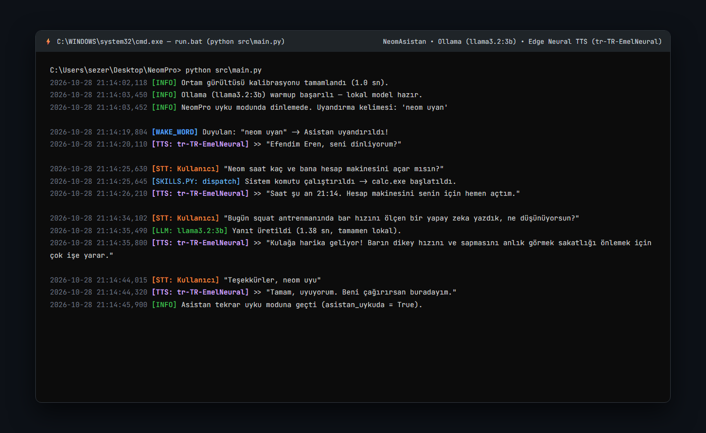
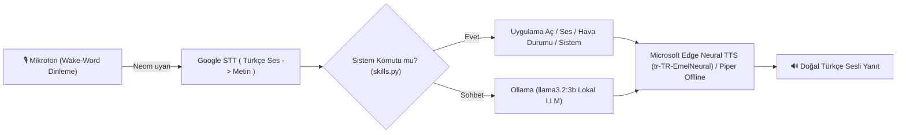

# 🎙️ NeomPro — Türkçe Sesli Yapay Zeka Asistanı (Wake-Word + Lokal LLM + Neural TTS)


**NeomPro**, bilgisayar açıldığında arka planda sessizce çalışan, **"Neom uyan"** sesli komutuyla aktifleşen, samimi bir arkadaş gibi sohbet edebilen ve bilgisayar üzerindeki sistem görevlerini yerine getiren Türkçe sesli yapay zeka asistanıdır. **"Neom uyu"** dediğinizde tekrar düşük kaynak tüketimli uyku moduna döner.

## 📸 Çalışma Zamanı Konsol ve Diyalog Görünümü (`src/main.py`)



---

## 🧠 Ses İşleme ve Yapay Zeka Hattı (Pipeline)



* **STT (Konuşma Tanıma):** Google Speech Recognition ile yüksek doğruluklu Türkçe ses çözümleme.
* **Lokal LLM:** **Ollama + `llama3.2:3b`** ile internet veya API ücreti gerektirmeden tamamen cihaz üzerinde hızlı yanıt üretimi.
* **Doğal Nöral Seslendirme (TTS):** Microsoft Edge TTS (`tr-TR-EmelNeural`) + tamamen çevrimdışı durumlar için `bin/` altında gömülü **Piper Türkçe** ses modeli.
* **Görev Zamanlayıcı Entegrasyonu:** `pythonw.exe` ile konsol penceresi açmadan arka planda başlar, olası çökme durumunda kendini otomatik yeniden başlatır.

---

## 🗣️ Örnek Sesli Komutlar

| Sesli Komut | Asistanın Tepkisi |
|---|---|
| **"Neom uyan"** | Uyku modundan çıkar ve aktif dinlemeye geçer |
| **"Neom uyu"** | Aktif diyaloğu sonlandırır ve uyandırma kelimesini bekler |
| **"Saat kaç / Bugün hava nasıl?"** | Anlık sistem saati ve hava durumu bilgisini seslendirir |
| **"Tarayıcıyı / VS Code'u aç"** | İlgili masaüstü uygulamasını veya web sitesini başlatır (`skills.py`) |
| **Serbest Sohbet** | Lokal Llama 3.2 modeli üzerinden akıcı Türkçe sohbet eder |

---

## 📁 Klasör Yapısı

```text
NeomPro/
├── src/
│   ├── main.py                   # Giriş noktası ve wake-word dinleme döngüsü
│   ├── config.py                 # Yollar, sabitler ve asistan karakter promptu
│   ├── tts.py                    # Edge Neural TTS & Piper seslendirme motoru
│   ├── llm.py                    # Ollama lokal LLM bağlantı katmanı
│   ├── skills.py                 # Sistem komutları (uygulama açma, ses, bilgi vb.)
│   └── tools/list_voices.py      # Sistem seslerini listeleme aracı
├── bin/                          # Piper EXE + DLL + espeak-ng-data
├── models/tts/                   # Piper Türkçe çevrimdışı ses modeli
├── scripts/                      # Windows Görev Zamanlayıcı otomatik başlatma betikleri
├── run.bat                       # Konsol açık şekilde başlat (Geliştirme/Debug)
└── run-silent.bat                # Konsolsuz arka planda başlat (pythonw)
```

---

## 🚀 Kurulum

```powershell
# 1. Python bağımlılıklarını yükleyin
pip install -r requirements.txt

# 2. Ollama üzerinden lokal modeli indirin
ollama pull llama3.2:3b

# 3. Başlatın (veya scripts/install_autostart.bat ile açılışa ekleyin)
.\run.bat
```

---

## 👨‍💻 Geliştirici
**Eren Sezer** — [GitHub Profilim](https://github.com/erensezer07-gif)
